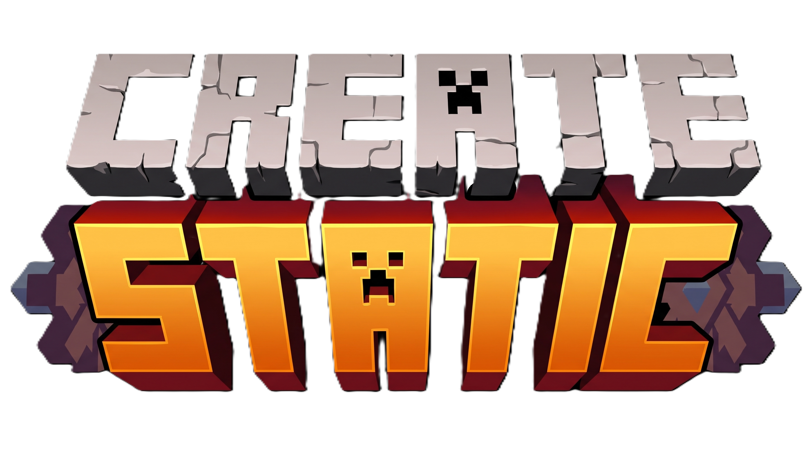

### ⚙️ GPU-Powered Performance for Massive Create Factories ⚙️

**Stop paying FPS for blocks nobody is looking at.**

---

## 🧩 The Problem

Create makes beautiful, intricate, *massive* factories — and that's exactly what kills your framerate.

Every rotating shaft, spinning cog, idle mixer, and chugging conveyor belt on your server is a **kinetic block entity**, animated and re-evaluated on the CPU every single client tick — whether you're looking at it or not, and whether it's actually doing anything or not. Drop a few thousand of these into a mega-factory and the result is predictable:

> **Vanilla chunk culling and client-side logic ticking buckle under the load, capping entire servers at 20–30 FPS even on high-end hardware.**

The tragedy? Most of that factory is **idle** most of the time. A mixer waiting for ingredients doesn't need to recalculate its spin every tick. A gearbox transmitting zero rotation to anything visible doesn't need CPU cycles spent animating it. You're burning performance animating machines that, functionally, aren't doing anything.

## 💡 The Solution

**CreateStatic** rearchitects how idle kinetic blocks are rendered and ticked — without ripping out Create's beloved GPU-accelerated Flywheel rendering engine.

Instead of fighting Flywheel, we work *with* it:

1. 🎮 **Offload to the GPU, not away from it.** We never force blocks back onto vanilla's `BlockEntityRenderer` or bake them into chunk meshes. Flywheel keeps doing what it does best — rendering thousands of instances efficiently on the GPU.
2. ❄️ **Freeze visual state via Flywheel math.** Rather than deleting or hiding instances (which causes visual pop-in, GC churn, and memory leaks), CreateStatic zeroes out the *rotational speed*, *scroll speed*, and *animation timers* directly inside Flywheel's own Visuals. The block is still rendered — it's just rendered standing perfectly still.
3. 🔪 **The Hard Logic Cull.** The real performance killer isn't rendering — it's ticking. CreateStatic intercepts `SmartBlockEntity#tick()` at the earliest possible hook and cancels client-side logic execution outright for frozen blocks, eliminating wasted CPU cycles entirely.

The result: your factory *looks* exactly the same, costs a fraction of the CPU/GPU budget, and your server's framerate stops apologizing for your creativity.

<!--
TODO: FPS comparison screenshots.
Uncomment and fill in once the images are added (e.g. assets/fps_before.png and assets/fps_after.png),
showing the same factory area at low FPS (vanilla Create) vs high FPS (with CreateStatic enabled).

| Before CreateStatic | After CreateStatic |
|---|---|
|  |  |

-->

## ✨ Feature Highlight: "Static Until In Use"

Freezing a shaft is easy — it either spins or it doesn't. Processing machines are trickier, because they need to look *alive* while actively working, then go dormant the instant they're done.

That's where our custom **Static Until In Use** architecture comes in. CreateStatic hooks directly into each machine's processing state so that:

| Machine | Idle State | Active State |
|---|---|---|
| 🥣 **Mixers** | Completely frozen — no spinning paddle, no particle churn | Paddle animation and mixing visuals resume instantly on a valid recipe |
| 🔨 **Mechanical Presses** | Piston locked in place, zero logic ticking | Full press-and-release animation plays smoothly for each item processed |
| 🛠️ **Crafters** | Static, dormant, invisible to the tick scheduler | Crafting arm animation and item transfer render seamlessly |
| 🦾 **Mechanical Arms** | Frozen mid-pose, holding zero compute budget | Smooth pick-up/drop-off motion across every configured target |

The transition is **seamless** — there's no visible "pop" or stutter when a machine wakes up. Visually, you'd never know anything was frozen at all. Functionally, your idle factory floor just stopped costing you anything.

## 📋 Requirements

| Dependency | Version |
|---|---|
| **Minecraft** | `1.20.1` |
| **Minecraft Forge** | `47.4.10` or higher |
| **Create** | `6.0.8` (bundles Flywheel `1.0.5`) |
| **Cloth Config API** | Required for the in-game settings menu |

> ⚠️ **Client-side only.** CreateStatic modifies rendering and client-tick behavior exclusively — it does **not** touch server logic. Install it on your client even if the server doesn't have it, and nothing will break for other players.

## 🚀 How to Use

1. Install CreateStatic alongside **Create**, **Forge**, and **Cloth Config API**.
2. Load into any world with a factory full of kinetic contraptions.
3. Press **`F9`** to open the **Cloth Config** menu.
4. Toggle static rendering on, and fine-tune exactly which block categories get frozen when idle — the menu gives you **granular, per-category control**. Want shafts and gears to keep spinning but everything else to freeze? Done. Want belts to keep moving while fans, mixers, and presses go static? Done. Every kinetic category (shafts, belts, fans, mixers, presses, crafters, arms, gauges, and more) has its own independent switch, so you can tune the exact balance of visual fidelity vs. performance for your setup.
5. Watch your FPS climb back up — no rebuild required.

That's it. No config files to hand-edit, no server-side installation, no compromise on how your factory looks.

---

**Build bigger. Render smarter.**

Made with ⚙️ by **Aryan Naik**

